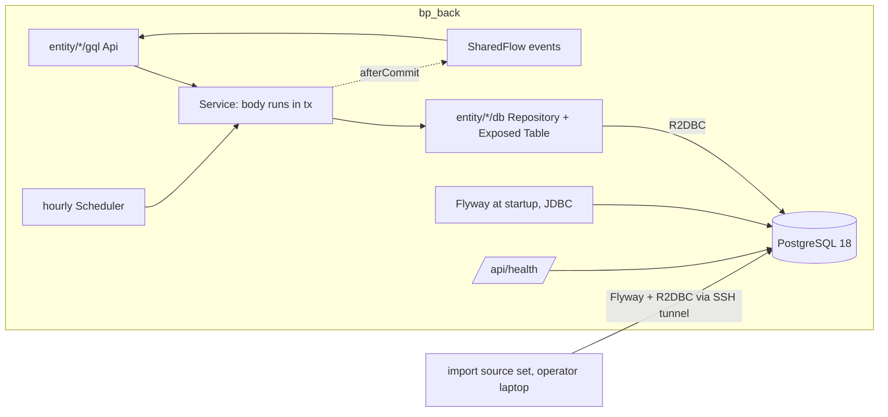
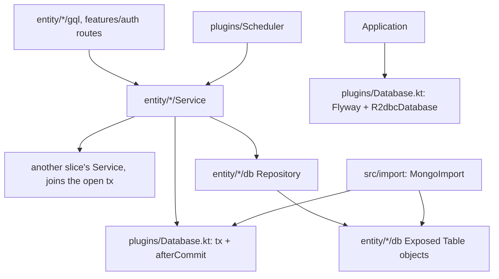
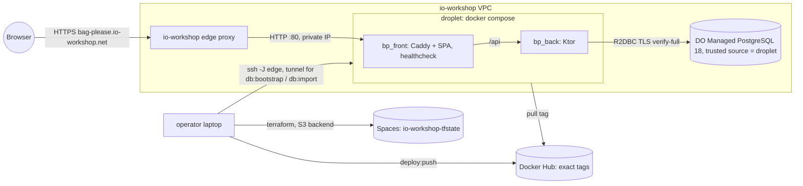
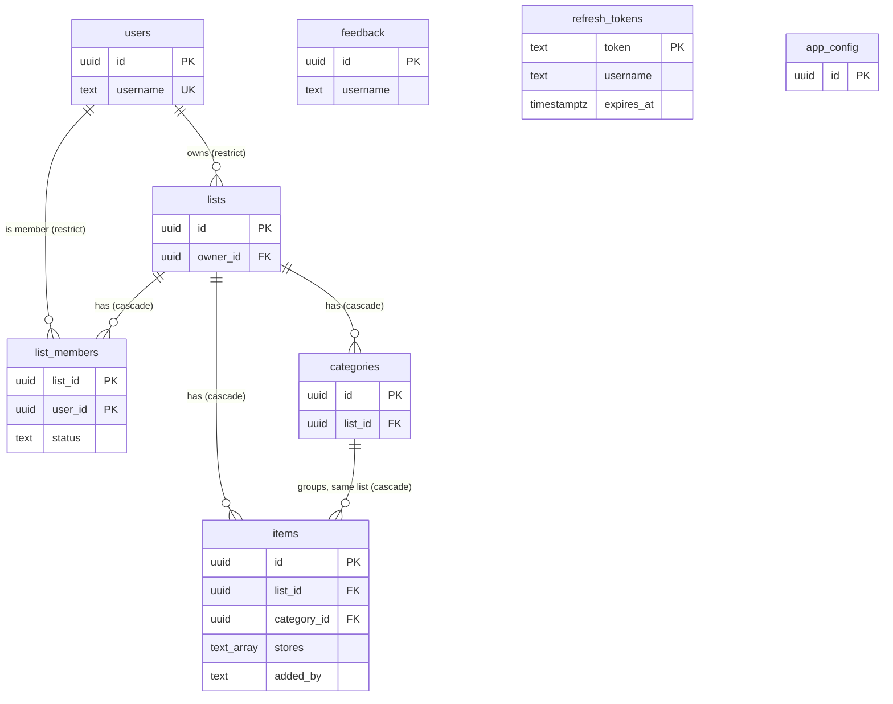

# Architecture Spine — Epic 11: PostgreSQL and a DigitalOcean Deployment

## Design Paradigm

A layered monolith built from per-entity vertical slices. Epic 11 changes the bottom of the backend: each slice's
`mongo/` package becomes `db/` (Exposed DSL tables and repositories on R2DBC), and every in-memory cache goes away.
Calls still go one way only: **GQL → Service → Repository → PostgreSQL**. A service method that touches the database is
one transaction, and the events it emits leave only after the outermost transaction commits. Flyway owns the schema.
Production is one droplet behind the existing io-workshop edge, plus one managed PostgreSQL cluster. Both are declared
in Terraform and released by operator-run mise tasks, following mal_ui. The frontend does not change.



## Inherited Invariants

| Inherited                                                                                   | From parent                                  | Binds here                                                                                                         |
|---------------------------------------------------------------------------------------------|----------------------------------------------|--------------------------------------------------------------------------------------------------------------------|
| Per-entity slice layout `entity/<name>/{Service, gql/, <store>/}`                           | `bp_back/CLAUDE.md`, code                    | `<store>` becomes `db/`. The `Storage` member is removed (AD-1).                                                   |
| NFR-L2: the service layer checks membership before any list-scoped access                   | `architecture.md` (Epic 4)                   | Unchanged. The check reads `list_members` inside the same `tx` as the guarded work (AD-2, AD-4).                   |
| FR56: admin excluded from list ops; the admin has no `users` row                            | `architecture.md`, `ListService`             | The admin never appears in `lists.owner_id` or `list_members`                                                      |
| Epic 9 AD-2: one admin GQL gate on the JWT `role` claim                                     | Epic 9 spine                                 | Unchanged                                                                                                          |
| Epic 9 AD-4: the server normalizes store names; identity is case-insensitive, casing is data | Epic 9 spine                                | `items.stores` stores the normalized list as is (AD-6)                                                             |
| Epic 9 AD-6: users sorted by `username` with binary collation; a server-located page         | Epic 9 spine                                | `users.username` is `COLLATE "C"` and `UNIQUE` (AD-6)                                                              |
| Epic 9 AD-7: category delete cascades on the server                                        | Epic 9 spine                                 | Now one `tx` (AD-2, AD-7)                                                                                          |
| Epic 9 AD-8: `ListService` alone writes membership; user deletion runs an admin-gated purge  | Epic 9 spine                                | Still true. The purge and the user delete become one service method in one `tx` (AD-2, AD-7).                      |
| Epic 9 AD-9: readiness is `/api/health`; any compose healthcheck runs on `bp_front` with busybox `wget`; no probe tool in `bp_back` | Epic 9 spine | The health route pings PostgreSQL. The droplet's healthcheck is on `bp_front` and is the deploy's wait (AD-13). |
| Epic 9 AD-11: one check-state transition for every item mutation                            | Epic 9 spine                                 | Unchanged                                                                                                          |
| Subscriptions filtered per list; `takeWhile` membership re-check on each event              | `architecture.md`, `bp_back/CLAUDE.md`       | The re-check becomes a suspend read in its own `tx` (AD-4)                                                         |
| Rate limiter keys on the client IP; Caddy trusts `private_ranges`                           | `routing/Caddyfile`, `routing/edge-proxy.md` | The edge reaches the droplet over the VPC, a private range. No change.                                             |
| E2E is UI-driven, desktop + mobile projects, runs against the production artifact           | NFR17, NFR18                                 | The stack runs `postgres:18` in Compose. The per-story gate is relaxed on the epic branch only (AD-15).            |

**Superseded by this epic, deliberately (md, 2026-10-21):**

| Superseded                                                                         | Was                                     | Replaced by     |
|------------------------------------------------------------------------------------|-----------------------------------------|-----------------|
| Layering `GQL → Service → Storage (ConcurrentMap, synced once) → Mongo`            | `bp_back/CLAUDE.md`                     | AD-1            |
| `ApplicationConfigService`'s `AtomicReference` cache                               | code                                    | AD-1            |
| GQL list resolvers reading `ListMemberRepository` / `ItemStorage` directly        | `ListApi.kt`                            | AD-2            |
| "Cascades are ordered, non-transactional Mongo deletes, followed by cache eviction" | Epic 9 spine, `ListService.deleteList` | AD-2, AD-7      |
| Epic 9 AR-E9-8: the user row is deleted first, then the purge runs (race guard)    | Epic 9 spine, `UserAdminApi.kt`         | AD-7            |
| Epic 9 AD-5 and FR47/FR69: startup migrations recorded in `app_migrations`          | Epic 9 spine, `Migration.kt`            | AD-5            |
| NFR2's TTL index                                                                   | `RefreshTokenRepository`                | AD-10           |
| Root CLAUDE.md "Dump before a migration release" (`mongodump`/`mongorestore`)      | root `CLAUDE.md`                        | AD-5, AD-20     |
| NFR17's per-story E2E gate, for Epic 11 only                                       | PRD                                     | AD-15           |
| NFR-D4's restore drill before cutover; NFR-D5's "export deleted"                   | PRD                                     | AD-20           |

## Invariants & Rules



### AD-1 — Services read and write PostgreSQL directly; no cache anywhere

- **Binds:** FR70, FR22; every slice (`item`, `category`, `list`, `user`, `feedback`, `config`, `features/auth`)
- **Prevents:** a cached slice serving rows that another slice, the importer or a rolled-back transaction left
  different, which is today's synced-once trap multiplied by cross-slice transactions
- **Rule:** `ItemStorage`, `CategoryStorage`, `ListStorage` and `ApplicationConfigService`'s `AtomicReference` are
  deleted, and no replacement cache is added. Each slice's `mongo/` package becomes `db/`, which holds its Exposed
  `Table` object, its row↔domain mapper and its repository. Domain models and the GraphQL schema keep their current
  shape and semantics: no user-visible behaviour changes (FR70).

### AD-2 — Transactions belong to services; GQL, routes and the scheduler never touch a repository

- **Binds:** FR70, NFR-L2, Epic 9 AD-7/AD-8; every service, `ListApi.kt`, `UserAdminApi.kt`, `AuthRoutes.kt`, `Scheduler.kt`
- **Prevents:** a multi-step workflow split across several transactions by its resolver, repositories called with no
  transaction open, and the same AD read as "public methods only"
- **Rule:** Every service method that touches the database, whatever its visibility, runs its body in `tx {}` (AD-17).
  Repositories run only inside `tx`. GQL resolvers, REST routes, subscriptions and the scheduler call services only.
  They never call a repository and never open `tx`. A workflow that spans slices is **one** service method that calls
  the others inside its own `tx`. That covers user deletion (`UserService.deleteUser`: count owned lists, purge, delete
  sessions, delete user), change-password + session invalidation, and list views with members and unchecked counts
  (`ListService` composes them, using `ItemService.countUncheckedByList(listIds)`, which, like `purgeUser`, does not
  re-check membership its caller has already proven). The membership check (NFR-L2) runs in the same `tx` as the
  work it guards.

### AD-3 — Subscription events fire only after the outermost commit

- **Binds:** every service that emits on a `SharedFlow` (`ItemService`, `CategoryService`, the scheduler steps)
- **Prevents:** subscribers seeing, or refetching, rows whose transaction rolls back, including a callee's events
  when its caller's transaction later fails
- **Rule:** Services never call `emit` inside a `tx` body. They register `afterCommit { channel.emit(x) }`. The queue
  belongs to the outermost transaction, runs only after it commits, and is dropped on rollback (AD-17). Event payloads
  and the set of events each operation emits stay as they are today.

### AD-4 — Membership lives in one table; the owner is an ACCEPTED member but not a listed member

- **Binds:** FR56, NFR-L2, Epic 9 AD-8, list sharing/invites, subscription scoping, GQL `List.members`
- **Prevents:** the three-way drift between `lists.members`, `lists.memberUsernames` and `list_members`, and a
  normalized table that silently changes what the API returns
- **Rule:** `list_members(list_id, user_id, status, created_at)` is the only record of membership and invites, with
  PK `(list_id, user_id)` and `status` ∈ `PENDING | ACCEPTED | DECLINED`. A list's owner holds an `ACCEPTED` row, written
  in the same `tx` that creates the list. Access is defined as an `ACCEPTED` row existing, for the owner and everyone
  else. The GQL `List.members` field keeps today's meaning: the `PENDING` and `ACCEPTED` rows **excluding the owner's**.
  The domain `members`/`memberUsernames` used by the Share dialog are derived the same way, never stored.
  `ListService.isMember` becomes `suspend`, and the subscription `takeWhile` re-check runs one indexed read in its own
  `tx`.

### AD-5 — Flyway owns the schema; migrations are DDL only and additive

- **Binds:** FR72, FR47/FR69 retirement, FR74 rollback
- **Prevents:** two definitions of the schema, seed rows that defeat the importer's emptiness check, and a rollback
  (`deploy <previous>`) that runs an image the current schema has outgrown
- **Rule:** The schema is created and changed only by Flyway migrations in
  `bp_back/src/main/resources/db/migration/V<n>__<snake_name>.sql`. They are applied at startup before GQL is
  configured, and by the importer before it loads. A shipped migration is never edited. Migrations hold DDL only, never
  data rows. Each migration is backward-compatible with the previous release's image: it only adds things. A drop or
  rename ships one release after the code stops using it. Exposed `Table` objects mirror the SQL and never issue DDL
  (`SchemaUtils`/`MigrationUtils` unused). `Migration.kt`, `AppMigrationsRepository` and `app_migrations` are deleted,
  and Mongo-era migrations are not ported.

### AD-6 — Column conventions and text references

- **Binds:** every table, Epic 9 AD-6
- **Prevents:** slices choosing different id, time, enum or ordering encodings, and FKs that delete history
- **Rule:** Primary keys are `uuid`, generated by the application, including `feedback.id` (the mapper converts the
  domain `String`). `app_config` keeps its fixed id `00000000-0000-0000-0000-000000000001`. A missing row means the defaults, reads never
write it, and only `update` upserts it. Every instant is
  `timestamptz`, mapped to `java.time.Instant` through `exposed-java-time`. Every enum is `text` with a `CHECK` listing
  its values. Identifiers are snake_case. `users.username` is `text COLLATE "C" UNIQUE`. `items.stores` is `text[]`,
  keeping order and casing. `items.added_by`, `feedback.username` and `refresh_tokens.username` are plain `text` with no
  FK. A unique violation (SQLSTATE `23505`) is translated by the repository into the slice's existing domain conflict.
  It aborts the transaction, which then rolls back (AD-17).

### AD-7 — Delete order: explicit in the service; list children cascade; users restrict

- **Binds:** list delete, category delete (Epic 9 AD-7), user deletion (Epic 9 AD-8)
- **Prevents:** a user-row delete silently cascading away lists before the counted, event-emitting purge runs, and
  cross-list category references
- **Rule:** FKs to `lists` (`items.list_id`, `categories.list_id`, `list_members.list_id`) are `ON DELETE CASCADE`, as
  a backstop. FKs to `users` (`lists.owner_id`, `list_members.user_id`) are `ON DELETE RESTRICT`. `items` references
  its category by `FOREIGN KEY (list_id, category_id) REFERENCES categories (list_id, id) ON DELETE CASCADE`, with
  `UNIQUE (list_id, id)` on `categories`. Services still delete children explicitly, in today's order, inside one `tx`.
  They return the same counts and register the same events. User deletion is one `tx`: lock the user row
  (`SELECT … FOR UPDATE`), purge owned lists, delete the user's `list_members` rows and refresh tokens, then delete the
  `users` row **last**. The row lock replaces Epic 9's "row first" race guard.

### AD-8 — Exposed DSL on R2DBC at runtime; JDBC only for Flyway; one connection config

- **Binds:** FR70, FR72, NFR-D3
- **Prevents:** a slice using DAO entities or blocking JDBC on a request path, and the Flyway and runtime connections
  pointing at different hosts or TLS modes
- **Rule:** Request and scheduler paths use the Exposed DSL over `R2dbcDatabase` (`r2dbc-postgresql` + `r2dbc-pool`).
  DAO (`Entity`/`EntityClass`) is not used. Blocking JDBC exists only for Flyway. `plugins/Database.kt` builds both URLs
  from one `db.postgres` block whose keys are `host, port, name, user, password, sslmode, sslrootcert`, read from env
  `KTOR_DB_HOST`, `KTOR_DB_PORT`, `KTOR_DB_NAME`, `KTOR_DB_USER`, `KTOR_DB_PASSWORD`, `KTOR_DB_SSLMODE` and
  `KTOR_DB_SSLROOTCERT`. `application.yaml` defaults are the local dev values. The foundation story proves, before any
  slice moves, that the app starts and connects to PostgreSQL over TLS with Ktor's Netty 4.2 and `r2dbc-postgresql`'s
  reactor-netty on one classpath.

### AD-9 — The import runs from the operator's machine through a tunnel, as one transaction

- **Binds:** FR71, NFR-D3, NFR-D5
- **Prevents:** a partly loaded database, a second definition of the schema, the managed DB opened to the internet, and
  an import racing a live backend
- **Rule:** The export is `mongoexport --jsonArray` per collection, relaxed Extended JSON, written to the gitignored
  `migration-export/` at the repo root. The importer is `com.bagplease.tools.MongoImport` in its own Gradle source set
  `bp_back/src/import/`. It depends on `main`, reuses the `db/` Table objects, and is not packaged into the image. It
  runs Flyway, then in one `tx`:
  1. Refuse if any of the eight application tables (`users`, `lists`, `list_members`, `categories`, `items`,
     `feedback`, `refresh_tokens`, `app_config`) holds a row. Flyway's history table is not one of them.
  2. Load per AD-18.
  3. Print export / loaded / dropped-with-reason for each record type.

  A failure rolls back to an empty database, so the import can be re-run. `db:import` refuses a dirty tree, and it
  refuses when `bp_back` is running on the droplet (checked over SSH). It reaches the cluster through
  `ssh -J <edge> -L <local port>:<cluster private host>:<port> deploy@<droplet>`, and only this connection uses
  `sslmode=verify-ca` (AD-14). It passes the `bag_please_app` credentials, read from `terraform output`, to the importer
  process only: never to Gradle, a file or the shell.

### AD-10 — Expired refresh tokens: rejected on read, purged hourly

- **Binds:** NFR2
- **Prevents:** relying on a database feature (TTL index, `pg_cron`) PostgreSQL lacks or the managed tier may not
  offer, and one failing scheduler step skipping the others
- **Rule:** `AuthService` keeps rejecting a token with `expires_at <= now()`. The scheduler cycle calls one service
  method per step: recurring restore, soft-delete hard-delete, and `AuthService.purgeExpiredTokens()`. Each step has its
  own `tx`. A step that throws is logged, and the following steps still run.

### AD-11 — Infrastructure follows mal_ui's Terraform layout; the database is private to the droplet

- **Binds:** FR73, NFR-D2, NFR-D3, NFR-D6
- **Prevents:** a replaced droplet silently moving the edge's upstream, a database reachable from outside the VPC, and
  the app running as the cluster administrator
- **Rule:** `deploy/terraform/` follows mal_ui's layout:
  - The VPC and SSH key are data sources.
  - The droplet sets `ignore_changes = [user_data, image]`.
  - The firewall allows only 80 and 22 from the edge's private IP.
  - State lives in the `io-workshop-tfstate` Spaces bucket under the key `bag-please/web.tfstate`.
  - `.terraform.lock.hcl` is committed.

  The managed cluster runs PostgreSQL 18 on the cheapest tier, in the same VPC. A `digitalocean_database_firewall` has
  exactly one trusted source, the droplet. Terraform creates database `bag_please` and user `bag_please_app`. That user
  is the only identity used by Flyway, the runtime and the importer. `doadmin` is used once only, by the `db:bootstrap`
  task over the tunnel, to give `bag_please_app` ownership of the `public` schema in `bag_please`. The first apply
  verifies against the real cluster that this is enough for Flyway. `infra:plan` and `infra:apply` are run by hand,
  and a deploy never runs Terraform.

### AD-12 — Secrets reach only the process that needs them

- **Binds:** NFR-D1, NFR-D2, NFR-D5
- **Prevents:** a secret in the public repo, an image, Terraform state in git, or Gradle's environment
- **Rule:** Operator secrets live in two gitignored files, each with a committed `.example` that has blank values and a
  comment per entry:
  - `.secure.build.env`: the Docker Hub user and image names. It absorbs `project.env`.
  - `.secure.deploy.env`: the DO token, Spaces key, `EDGE_SSH`, `TF_VAR_*`, `KTOR_JWT_SECRET`, `KTOR_ADMIN_LOGIN`
    and `KTOR_ADMIN_PASS`.

  mise loads them per task. `lib.sh`'s strip list removes every variable of `.secure.deploy.env`, including `KTOR_*`,
  before any nested Gradle or mise task. Runtime secrets reach the droplet only in the deploy-written `bag-please/.env`
  (mode `600`, owned by `deploy`). The deploy reads the DB credentials from `terraform output` and refuses to write an
  empty value. `.gitignore` covers `.secure.*.env`, `migration-export/`, `*.tfstate*`, `*.tfvars`, `.terraform/`,
  `crash.log` and `*.archive` **before** the first such file exists. Images, compose files and committed Terraform hold
  no secret.

### AD-13 — Release is an exact, immutable tag rolled onto the droplet

- **Binds:** FR74, Epic 9 AD-9
- **Prevents:** `latest` drift, an overwritten tag, and a deploy that reports success while the app is down or the
  public URL still points elsewhere
- **Rule:** The version is `gradle.properties`' `version`. `deploy:push` refuses a tag that already exists on Docker Hub
  and never pushes `latest`, replacing `images:build-push`. `deploy` with no argument:
  1. Refuses a dirty tree.
  2. Runs `back:test`, then builds and pushes.
  3. Writes `.env` and runs `docker compose pull && up -d`.
  4. Waits for `bp_front`'s healthcheck (busybox `wget` of `/api/health` through Caddy, so it covers the backend and
     the database).
  5. Smoke-tests the droplet over the edge jump host (`http://<private ip>/api/health`).

  The public `https://bag-please.io-workshop.net/` is checked by `deploy:status`, which also prints the running version.
  `deploy <version>` redeploys a pushed tag, which is the rollback, safe across migrations by AD-5. On failure the deploy
  prints the rollback command and never rolls back by itself.

### AD-14 — TLS to the database is `verify-full`, with one named exception

- **Binds:** NFR-D3
- **Prevents:** a runtime "fix" that downgrades verification to match the importer, and a production config that falls
  back to a dev default
- **Rule:** The droplet compose file hardcodes `KTOR_DB_SSLMODE: verify-full` and
  `KTOR_DB_SSLROOTCERT: /etc/bag-please/ca-certificate.crt`. These are committed and are not secrets. The deploy writes
  the CA, from the `digitalocean_database_ca` data source, to `bag-please/ca-certificate.crt` with mode `644` and mounts
  it read-only. The infra story verifies once from the droplet that `verify-full` passes against the cluster's private
  host. The importer through the tunnel (AD-9) is the only connection allowed `verify-ca`. Local dev, E2E and
  Testcontainers run without TLS.

### AD-15 — Stories land on the `epic-11` branch; `main` never runs two stores

- **Binds:** all Epic 11 stories, NFR17
- **Prevents:** a `main`, or a release, that reads some slices from Mongo and others from PostgreSQL, and dual writes
- **Rule:** Epic 11 stories merge into a long-lived `epic-11` branch, in AD-19's order. On that branch the E2E suite
  may be red between stories, but each story keeps `back:test` green for what it touches. A slice is either on Mongo or
  on PostgreSQL, never both, and no code writes one entity to both stores. `epic-11` merges to `main` once, when Mongo
  is gone from code, Compose, tests and docs and the full NFR17 suite passes. This is a scoped exception to NFR17's
  per-story gate (md, 2026-10-21).

### AD-16 — PostgreSQL 18 in every environment

- **Binds:** FR70, NFR17
- **Prevents:** SQL that passes in tests on one major version and fails in production on another
- **Rule:** `docker-compose.yaml` runs `postgres:18`, with fixed dev credentials (not secrets, per NFR-D1) and a named
  volume mounted at `/var/lib/postgresql`. That is the image's volume path from 18 on, not the old `…/data`. The
  `db_data` Mongo volume and the `mongo` service are removed. Testcontainers uses `postgres:18`, and the managed
  cluster runs 18. A major-version change moves all three together.

### AD-17 — One transaction helper owns commits and after-commit events

- **Binds:** AD-2, AD-3; every service; the importer
- **Prevents:** a joined callee's events escaping a rolled-back caller, a `Left` that commits half a workflow, a retry
  that re-runs non-idempotent work, and a developer enabling savepoints locally
- **Rule:** `plugins/Database.kt` exports `suspend fun <T> tx(block: suspend TxScope.() -> T): T`. It is the only
  caller of `suspendTransaction`.
  - It joins the transaction already open on the coroutine context, or opens one.
  - `useNestedTransactions = false`, and the maximum attempts is 1, so nothing is retried implicitly.
  - `TxScope.afterCommit {}` queues an action on the outermost transaction. The queue runs after that transaction
    commits and is dropped on rollback.
  - Arrow `raise` inside `tx` propagates out of it and rolls the transaction back. Services put `either {}` outside
    `tx {}`, so a `Left` always means nothing was written.

  The foundation story's tests prove two things: a rolled-back outer `tx` drops a joined callee's queued events, and a
  `raise` rolls back.

### AD-18 — Import mapping

- **Binds:** FR71, AD-4, AD-6, AD-7, AD-9
- **Prevents:** the importer and the runtime disagreeing on ids, membership or relations, and one bad legacy reference
  aborting the whole import
- **Rule:**
  - **Ids.** Every id field is accepted as a UUID string or as `$binary` subtype `04` or `03`. `users._id` is binary
    today; the other ids are strings. `list_members._id` (`"<listId>_<userId>"`) is not carried, because the PK is
    `(list_id, user_id)`.
  - **Membership.** Each list's `memberUsernames`, resolved through `users.username`, is authoritative for `ACCEPTED`,
    and the owner is always `ACCEPTED`. A `list_members` document adds a `PENDING` or `DECLINED` row only for a user not
    already `ACCEPTED`. `lists.members` ids are not used.
  - **Dropped rows.** These rows are dropped and counted as dropped, with the reason:
    - a member username or member id that resolves to no user
    - a list whose owner resolves to no user
    - an item with a null `listId`
    - an item whose category is the nil UUID or does not exist in the same list
    - a category with a null `listId`
  - **Not imported.** Refresh tokens. `app_config` is imported as its single row.
  - **Dates.** `{"$date": …}` maps to `timestamptz`.

### AD-19 — Slice order on the branch

- **Binds:** AD-15, all Epic 11 stories
- **Prevents:** a slice moving to PostgreSQL before a parent its FKs reference, and the spine's FKs being edited per story
- **Rule:**
  1. **Foundation.** `plugins/Database.kt` with `tx`, `afterCommit` and Flyway; `V1__baseline.sql` with the
     **whole** Epic 11 schema; `postgres:18` in Compose and Testcontainers next to Mongo; the Netty/TLS proof (AD-8).
  2. `user` + `features/auth` + `config` + `feedback`.
  3. `list` + membership.
  4. `category`.
  5. `item` + scheduler steps.
  6. Mongo removal: code, `mongo` service, `db_data`, Testcontainers mongo, docs.
  7. Importer (`db:import`, `db:bootstrap`).
  8. Terraform.
  9. Deploy tasks + droplet compose.
  10. Cutover.

  A later slice may reference an earlier one, never the reverse. Until both ends of a cross-slice call are on
  PostgreSQL, that call is not atomic. That is accepted on the branch only.

### AD-20 — Cutover order and the data-safety envelope

- **Binds:** FR71, NFR-D4, NFR-D5, PRD Epic 11 cutover
- **Prevents:** the runtime writing to the target before the import, verification against the wrong deployment, and
  NFR-D4/NFR-D5 being silently reinterpreted
- **Rule:** The cutover runs in this order:
  1. `infra:apply`.
  2. `db:bootstrap`.
  3. md takes the Mongo export.
  4. `db:import` (`bp_back` not yet deployed).
  5. md checks the counts.
  6. `deploy`, with the droplet smoke test.
  7. md checks both users' data through the edge jump.
  8. Repoint the edge.
  9. `deploy:status`.
  10. Retire the old deployment.

  `migration-export/` is removed from the repo working tree once the import is verified. md keeps the Mongo export or
  archive off-repo, in their own storage, as the only fallback, and restores it manually if ever needed. There is no
  restore drill. The managed tier's own daily backups are the only automated protection, and md accepts losing
  production data (2026-10-21). The PRD's NFR-D4, NFR-D5 and risk rows are to be amended to match.

## Consistency Conventions

| Concern            | Convention                                                                                                                                                                                                         |
|--------------------|--------------------------------------------------------------------------------------------------------------------------------------------------------------------------------------------------------------------|
| Package naming     | `entity/<name>/db/` holds `<Name>Table.kt` (Exposed `object <Name>s : Table("<snake_plural>")`), `<Name>RowMapper.kt` and `<Name>Repository.kt`; `features/auth/db/`, `config/db/`                               |
| Table names        | `users`, `lists`, `list_members`, `categories`, `items`, `feedback`, `refresh_tokens`, `app_config`; FK columns `<parent>_id`                                                                                       |
| Migrations         | `V<n>__<snake_name>.sql`; `V1__baseline.sql` is the whole Epic 11 schema; one concern per later file; DDL only                                                                                                      |
| Indexes            | Carry today's intents: `users(username)` unique, `items(list_id)`, `items(list_id, recurring, checked_at)`, `items(deleted, deleted_at)`, `list_members(user_id, status)`, `refresh_tokens(expires_at)`, `refresh_tokens(username)`; any other only with a reason in its migration |
| Config & env       | `db.postgres.*` / `KTOR_DB_*` (AD-8); `db.mongo.*`, `KTOR_MONGO_*` and `MIGRATION_TARGET_USER` deleted                                                                                                             |
| Errors             | Repository exceptions propagate. Expected outcomes (not found, `23505` conflict) become the slice's existing `Either` errors in the service, outside `tx` (AD-17). GQL never inspects SQL state.                  |
| Tests              | Kotest `FunSpec`; `FunSpec.postgresContainer()` replaces `mongoContainer()`; schema by running Flyway, never `SchemaUtils`; fixtures write through services, repositories inside `tx`, or SQL                    |
| Remote layout      | Droplet dir `bag-please/`: `docker-compose.yml` (from `deploy/docker-compose.yml`), `.env` (600), `ca-certificate.crt` (644)                                                                                        |
| Droplet compose    | `bp_front` published only on `${PRIVATE_IP}:80`; `bp_back` unpublished; both `read_only`, `tmpfs: [/tmp]`, `cap_drop: [ALL]` (`bp_front` adds `NET_BIND_SERVICE`), `no-new-privileges`, `mem_limit`; `bp_back` gets an explicit `-Xmx` through `JAVA_OPTS` |
| mise tasks         | `infra:plan`, `infra:apply`, `db:bootstrap`, `db:import`, `deploy:build`, `deploy:push`, `deploy`, `deploy:status`; each loads only the `.secure.*.env` it needs                                                    |
| Docs               | The epic updates root `CLAUDE.md` (stack, commands, backup section), `bp_back/CLAUDE.md` (layers, tests, `tx`), and adds `deploy/README.md` (operator runbook, AD-20)                                             |

## Stack

| Name                                                       | Version                     |
|------------------------------------------------------------|-----------------------------|
| PostgreSQL (Compose, Testcontainers, managed)              | 18                          |
| `org.jetbrains.exposed:exposed-core` / `exposed-r2dbc` / `exposed-java-time` | 1.6.0     |
| `org.postgresql:r2dbc-postgresql`                          | 1.1.3.RELEASE               |
| `io.r2dbc:r2dbc-pool`                                      | 1.0.2.RELEASE               |
| `org.flywaydb:flyway-core` / `flyway-database-postgresql`  | 13.11.1                     |
| `org.postgresql:postgresql` (JDBC, Flyway only)            | 42.7.14                     |
| `org.testcontainers:testcontainers-postgresql`             | 2.0.5                       |
| Terraform                                                  | ~> 1.15 (as mal_ui)         |
| `digitalocean/digitalocean` provider                       | ~> 2.106                    |
| Kotlin / Ktor / JDK (unchanged)                            | 2.4.21 / 3.6.0 / temurin-25 |

## Structural Seed





```text
bp_back/src/
  main/kotlin/com/bagplease/
    entity/<name>/db/            # <Name>Table, <Name>RowMapper, <Name>Repository (replaces mongo/)
    config/db/, features/auth/db/
    plugins/Database.kt          # db.postgres config → R2dbcDatabase + Flyway; tx + afterCommit
  main/resources/db/migration/   # V<n>__*.sql (Flyway, DDL only)
  import/kotlin/com/bagplease/tools/MongoImport.kt   # FR71 importer, own source set, not in the image
deploy/
  terraform/                     # main.tf, variables.tf, outputs.tf, versions.tf, cloud-init.yaml.tftpl, .terraform.lock.hcl
  scripts/                       # lib.sh, infra.sh, build.sh, push.sh, deploy.sh, smoke.sh, status.sh, bootstrap-db.sh, import.sh
  docker-compose.yml             # droplet compose (hardened)
  README.md                      # operator runbook (AD-20)
.secure.build.env.example, .secure.deploy.env.example
migration-export/                # gitignored; mongoexport output, removed after verify
```

## Capability → Architecture Map

| Capability / Area                     | Lives in                                                            | Governed by                                      |
|---------------------------------------|---------------------------------------------------------------------|--------------------------------------------------|
| FR70 PostgreSQL everywhere            | `entity/*/db`, `plugins/Database.kt`, `docker-compose.yaml`, tests | AD-1–AD-4, AD-6, AD-7, AD-8, AD-16, AD-17, AD-19 |
| FR71 one-time import                  | `src/import`, `deploy/scripts/import.sh`, `db:import`              | AD-9, AD-18, AD-12, AD-14, AD-20                 |
| FR72 versioned startup migrations     | `resources/db/migration`, `plugins/Database.kt`                    | AD-5, AD-8                                       |
| FR73 Terraform droplet + managed PG   | `deploy/terraform/`, `db:bootstrap`                                | AD-11, AD-14                                     |
| FR74 one-command release + status     | `deploy/scripts/`, `mise.toml`, `deploy/docker-compose.yml`        | AD-13, AD-12, AD-5                               |
| NFR2 refresh-token expiry             | `AuthService`, `plugins/Scheduler.kt`                              | AD-10                                            |
| NFR17 E2E on the production artifact  | `docker-compose.yaml`, `bp_front/e2e`                              | AD-15, AD-16                                     |
| NFR-D1/D2 secrets, state              | `.gitignore`, `.secure.*.env.example`, `lib.sh`                    | AD-12                                            |
| NFR-D3 DB private + TLS               | `deploy/terraform/`, `plugins/Database.kt`, droplet compose        | AD-11, AD-14                                     |
| NFR-D4/D5 data safety, export         | managed cluster, `migration-export/`, md's off-repo archive        | AD-20                                            |
| NFR-D6 cost floor                     | `deploy/terraform/variables.tf`                                    | AD-11                                            |

## Deferred

- **Droplet size slug, `-Xmx`, `mem_limit` values, R2DBC pool size.** These are chosen in the Terraform/deploy stories,
  against the smallest droplet that runs both containers (NFR-D6). One story sets each.
- **Edge configuration** for `bag-please.io-workshop.net`. It belongs to the io-workshop edge, outside this repo.
- **Observability.** `docker compose logs` on the droplet and `deploy:status` are enough at this scale. There is no
  metrics stack.
- **Indexes beyond the carried list.** They are added only when a query needs one, each in its own migration (AD-5).
